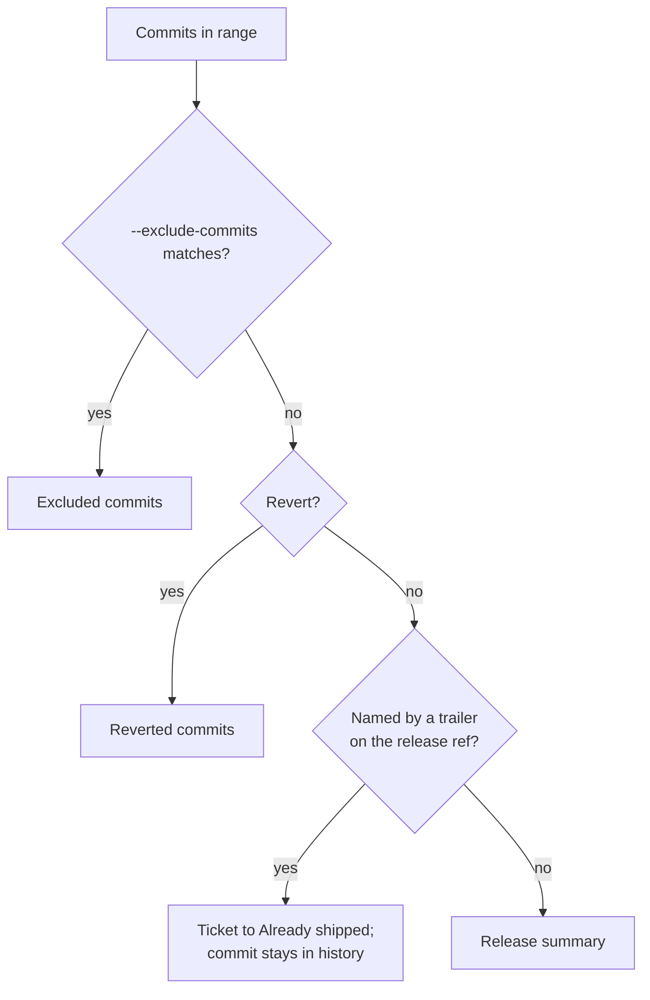
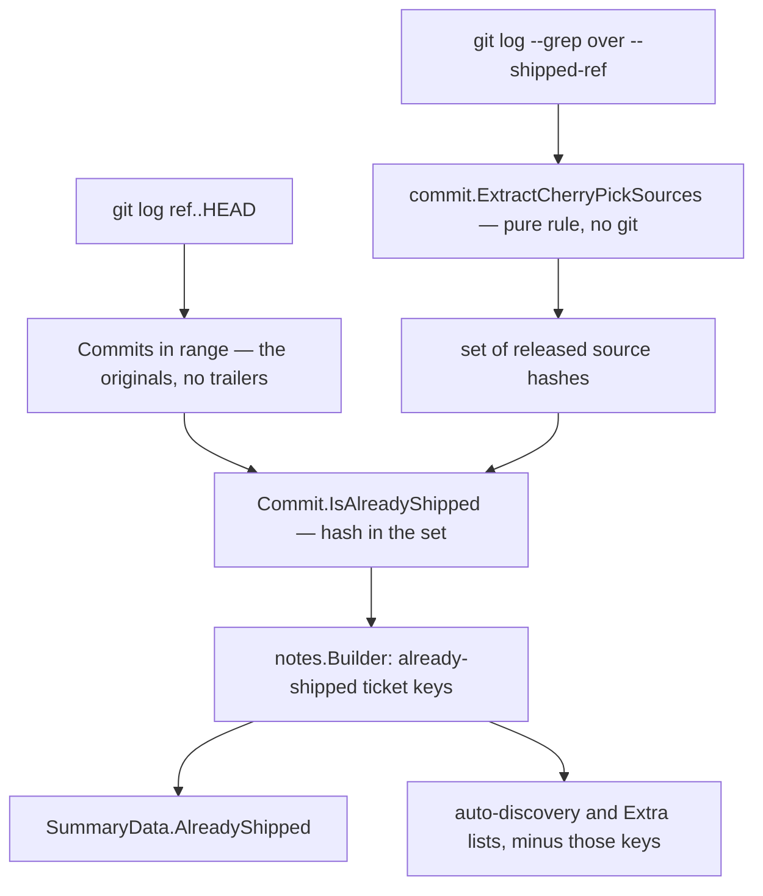

# Skip Already-Shipped Cherry-Picks - Plan

## Goal Capsule

- **Objective:** Stop shipnotes from presenting already-released work as new. When a fix was cherry-picked out to a release branch and shipped from there, the original still sits in the next range — its issue should say so instead of appearing in the release summary.
- **Authority hierarchy:** The Product Contract wins on product behavior. A Key Technical Decision wins on mechanism within its cited requirements. An Implementation Unit overrides neither. `CLAUDE.md` and `ARCHITECTURE.md` govern code style and structure.
- **Execution profile:** One Go module, no new dependencies, one new flag. The output is byte-locked by golden files, so the rendering change is a reviewed diff.
- **Stop conditions:** Stop and ask if the work would require a new port on `commit.Repository`, a new dependency, or a change to what `<ref>..HEAD` means.
- **Tail ownership:** This plan ends at a green local build. It does not own commits, branches, or a PR.
- **Open blockers:** None.

---

## Product Contract

**Preservation note:** Changed — R1, R2, R3, KD1, KD2, KD7. The original contract detected the wrong direction. It assumed the *cherry-pick* lands in the reported range with its source behind the range start; the real workflow puts the *original* in the range while the copy lives on a separate release branch. Because git writes the `cherry picked from commit …` trailer on the copy, the original carries no trailer and the original rules could never fire. The reference point (KD2) and the flag-free posture (KD7) fell with them. R4–R12 and every rendering requirement are unchanged — the classification and output half of the contract was correct and shipped as written. The two questions the brainstorm deferred to planning are resolved as KTD3 and KTD4 and no longer appear as questions.

### Summary

Read the release branch to find work that already went out. `git cherry-pick -x` records `(cherry picked from commit <hash>)` on the copy, so one pass over that branch collects every commit it took. An issue whose commits in the range are all named there moves to an "Already shipped" section, while the commits stay in the history table.

### Problem Frame

Some work ships ahead of the release it belongs to. A fix lands on the development branch. A release branch is cut from the default branch, the fix is cherry-picked onto it, and it merges to production. The development branch keeps moving.

When the next range is cut from that development branch, the original commit is inside it. Nothing about it looks released — it is an ordinary commit with an ordinary Jira key — so the release notes list its ticket alongside genuinely new work. The reader has to remember which tickets already went out, and the document offers nothing to check that memory against.

The trap is that the evidence exists but points the wrong way. Git records the link on the copy, over on the release branch, naming the original. Reading the range alone can never surface it. `--exclude-commits` can suppress a ticket by hand, but that is manual, silent, and stale by the next release.

### Requirements

#### Detection

- R1. A commit in the range is *already shipped* when a commit reachable from the release ref carries a `(cherry picked from commit <hash>)` trailer naming it.
- R2. The release ref is the `--shipped-ref` value, or the repository's default branch when the flag is absent.
- R3. When no release ref resolves, or it cannot be read, no commit is already shipped and the output is unchanged.

#### Ticket classification

- R4. A ticket is already shipped only when every commit in the range carrying that ticket key is already shipped per R1.
- R5. An already-shipped ticket is omitted from the auto-discovered issue summary. This covers both auto-discovery paths: the fallback that summarizes every key found in the range when no `--jql` is given, and the "Extra" list of commit keys that fall outside an explicit `--jql` selection.
- R6. A ticket named by `--jql` stays in the release summary even when R4 holds, and additionally appears in the already-shipped section.

#### Output

- R7. Already-shipped tickets appear in a dedicated "Already shipped" section of the release summary, showing issue key, title, and status.
- R8. Every already-shipped commit remains in the commit history table, rendered exactly as it is today.
- R9. The already-shipped section is omitted entirely when nothing was detected.
- R10. Authors of already-shipped commits stay credited under Participants.

#### Precedence with the existing gates

- R11. A commit matched by `--exclude-commits` never contributes to already-shipped classification; it appears only under "Excluded commits".
- R12. A commit that is both a revert and already shipped is listed in the "Reverted commits" callout rather than "Already shipped"; reverts already leave the issue summary, so the classification adds nothing.

### Key Decisions

- KD1. **Read the trailer from the release branch, not from the range.** Git writes it on the copy, naming the original, so the commit arriving in the range carries nothing to inspect. Governs R1.
- KD2. **The release ref is named, defaulting to the repository's default branch.** Nothing in the reported branch's own history knows what shipped elsewhere, so the ref is required evidence rather than a preference. Governs R2.
- KD3. **Relocate, don't delete.** (session-settled: user-directed — chosen over dropping the ticket silently: the notes stay auditable, matching the existing "Excluded commits" precedent.) Governs R7, R8.
- KD4. **A `--jql` selection appears in both lists rather than being reconciled.** (session-settled: user-directed — the discrepancy between what you expected to ship and what already shipped is the signal, and resolving it for the reader hides it.) Governs R6.
- KD5. **A ticket ships now unless all of its commits already shipped.** (session-settled: user-approved — the opposite rule would erase real work whenever a ticket spans a hotfix and a follow-up.) Governs R4.
- KD6. **Fail open on missing evidence.** No ref, an unreadable ref, or a history with no trailers all mean "nothing detected", never "everything shipped". Governs R3.

### Key Flows

- F1. Fix released ahead of its branch, no `--jql`
  - **Trigger:** A fix lands on the development branch, is cherry-picked with `-x` onto a release branch, and ships. A later range is cut from the development branch.
  - **Steps:** shipnotes reads the range; a pass over the release ref finds a trailer naming the in-range original; the ticket has no other commit in the range; the ticket moves to the already-shipped section.
  - **Outcome:** The release summary lists only new work. The already-shipped section names the ticket, and the commit history table still shows the commit.
  - **Covers:** R1, R2, R4, R5, R7, R8

- F2. The same fix inside an explicit release selection
  - **Trigger:** The same range, but `--jql` names the release issues and one of them is the already-shipped ticket.
  - **Steps:** Detection runs as in F1; the ticket is already shipped per R4 but was explicitly selected, so it stays grouped by status in the release summary and is also listed as already shipped.
  - **Outcome:** The reviewer sees the same ticket in two places and can tell that a ticket they expected to ship has in fact already gone out.
  - **Covers:** R6, R7

### Acceptance Examples

- AE1. **Covers R1, R4, R5, R7.** Given `PROJ-101` is carried by exactly one commit in the range, and a commit on the release ref names that commit in a cherry-pick trailer, when notes are generated without `--jql`, then `PROJ-101` appears under "Already shipped" and nowhere else in the summary.
- AE2. **Covers R4.** Given `PROJ-102` is carried by two commits in the range, one named by a release-ref trailer and one not, when notes are generated, then `PROJ-102` is summarized as part of this release and does not appear under "Already shipped".
- AE3. **Covers R3.** Given the release ref does not exist, cannot be read, or was not resolved, when notes are generated, then no commit is already shipped and no "Already shipped" heading appears.
- AE4. **Covers R2.** Given `--shipped-ref` is absent and the repository records a default branch, when notes are generated, then that branch is the one scanned for trailers.
- AE5. **Covers R6.** Given `--jql` names `PROJ-103` and every commit carrying it in the range is already shipped, when notes are generated, then `PROJ-103` appears both in its status group in the release summary and under "Already shipped", and never under "Missing".
- AE6. **Covers R11.** Given a commit matches `--exclude-commits` and is also named by a release-ref trailer, when notes are generated, then it appears only under "Excluded commits".
- AE7. **Covers R9.** Given no commit in the range is already shipped, when notes are generated, then the output contains no "Already shipped" heading.

### Scope Boundaries

- Patch-id equivalence (`git cherry`). A cherry-pick made without `-x`, or one whose original was rewritten afterwards, is not detected.
- Detecting the reverse direction — a cherry-pick inside the range whose source is behind the range start. It never occurs in the target workflow, where the in-range commit is always the trailer-less original.
- Rewriting, merging, or annotating rows in the commit history table.

### Dependencies / Assumptions

- The team cherry-picks with `git cherry-pick -x`, so the trailer exists. Without it nothing is detected and the output is unchanged.
- The original commit is not rewritten after being cherry-picked; the trailer records a hash, so a rebase of the original breaks the link.
- The release ref is present locally. A ref that was never fetched reads as no evidence per R3.
- The output is byte-locked by golden files, so the new section is a reviewed change to the rendering contract.

### Sources / Research

- `internal/domain/notes/builder.go` — `Build` establishes the gate order (exclude, then revert, then reapply) and the auto-discovery fallback that R5 narrows.
- `internal/domain/notes/exclude.go` — the relocate-don't-delete precedent KD3 follows.
- `internal/infrastructure/git/repository.go` — `Log` reads `<ref>..HEAD`; `run` returns an error on any non-zero git exit.
- `internal/infrastructure/git/remote.go` — the existing inference-with-warning pattern `--shipped-ref` resolution mirrors.
- `internal/infrastructure/git/parser.go` — `parseMessageAndTopic` captures the full body, so a trailer survives parsing with no parser change.
- `internal/infrastructure/git/repository_internal_test.go` — `TestRepositoryAgainstRealRepo` builds a temp repo with real `git` commands; the detection tests extend that harness with a develop/master cherry-pick.
- `internal/infrastructure/markdown/renderer_test.go` and `testdata/` — every `cases/*.json` fixture is rendered and compared byte-for-byte against its `golden/*.golden`.

---

## Planning Contract

### Key Technical Decisions

- KTD1. **Resolve detection in the git adapter and carry it as a flag on the commit.** `commit.Commit` gains `IsAlreadyShipped`, filled by the adapter exactly as `IsRevert` and `IsReapply` are. The trailer rule stays a pure function in the commit domain; only the release-ref scan needs git, and the adapter already owns every git call. No new port on `commit.Repository`. Governs R1.
- KTD2. **Scan the whole release ref, not a slice of it.** A copy can predate the range it was taken from, and a release branch merged back into the reported branch moves any merge-base cutoff past the evidence, so every bound risks a miss. One `git log --grep` over the full ref is a single call and always correct. Governs R1.
- KTD3. **Accept only `[0-9a-f]{7,40}` from the trailer, and validate the ref where it reaches git.** Both values come from outside the program and end up on the git command line; the adapter's standing contract, recorded in its `//nolint:gosec` note, is that every argument is format-checked in the function that uses it. A ref must also start with an alphanumeric so git can never read it as an option. Governs R1, R2.
- KTD4. **Render "Already shipped" grouped by status, reusing the `Extra` block's shape.** Status becomes the group heading, so R7's three fields need no new line format and the template gains no new shape. Governs R7.
- KTD5. **Classify tickets from the post-revert commit set.** Running R4's every-commit test over `normalCommits` rather than all kept commits makes R12 fall out with no separate branch: reverts have already left that set. Governs R4, R12.

### High-Level Technical Design

Detection crosses one layer boundary and stops. The commit domain owns the message rule, the git adapter owns the release-ref scan, and the notes domain owns everything downstream.

---

## Implementation Units

### U1. Cherry-pick trailer rule in the commit domain

- **Goal:** A pure function that extracts the source hashes a message references, plus the field the adapter fills.
- **Requirements:** R1; KTD3
- **Dependencies:** none
- **Files:** `internal/domain/commit/commit.go`, `internal/domain/commit/commit_test.go`
- **Approach:** `ExtractCherryPickSources` beside `ExtractIssueIDs`, backed by a package-level compiled regexp, de-duplicated in first-seen order, always non-nil. `IsAlreadyShipped` on `Commit`, documented as adapter-filled like the other classification fields.
- **Patterns to follow:** `ExtractIssueIDs` for the regexp-plus-dedupe shape; the `Commit` doc comment that explains adapter-filled fields.
- **Test scenarios:** one trailer; two trailers in order; no trailer; empty message; a hash too short, non-hex, uppercase, or too long yields nothing (covers KTD3); an indented trailer still matches; a repeated hash appears once.
- **Verification:** `go test ./internal/domain/commit/...` passes.

### U2. Release-ref scan in the git adapter

- **Goal:** `Log` fills `IsAlreadyShipped` from what the release branch says it took.
- **Requirements:** R1, R2, R3; KTD1, KTD2, KTD3
- **Dependencies:** U1
- **Files:** `internal/infrastructure/git/repository.go`, `internal/infrastructure/git/remote.go`, `internal/infrastructure/git/repository_internal_test.go`
- **Approach:**
  1. `Repository` gains a `shippedRef` field, set at construction; empty disables detection.
  2. `releasedSources` runs one `git log --grep='cherry picked from commit' --format=%B <ref>` and feeds the whole output through `ExtractCherryPickSources`, yielding the released-hash set.
  3. `markAlreadyShipped` flags any commit whose `CanonicalHash` is in that set.
  4. `IsValidRefName` guards the ref where it reaches git; any read failure yields an empty set rather than an error, per R3.
  5. `InferDefaultBranchRef` reads `refs/remotes/origin/HEAD` for the default.
- **Patterns to follow:** the `r.run(ctx, ...)` helper and the format-validation discipline in its `//nolint:gosec` note; `InferRemoteBaseURL` for inference that degrades to empty.
- **Test scenarios:** a real temp repo reproducing the workflow — fix on `develop`, `cherry-pick -x` onto `master`, range read from `develop` — asserts the original is flagged and unrelated work is not (covers AE1, AE2). No ref, a non-existent ref, and an option-shaped ref each leave every commit unflagged with no error (covers AE3). `IsValidRefName` accepts branch and tag shapes and rejects leading-dash, whitespace, and shell metacharacters.
- **Verification:** `go test ./internal/infrastructure/git/...` passes and `Log` returns a nil error in every scenario.

### U3. Already-shipped classification and summary section

- **Goal:** The builder computes already-shipped ticket keys and emits the new summary section.
- **Requirements:** R4, R5, R6, R7, R8, R9, R10, R11, R12; KTD4, KTD5
- **Dependencies:** U1
- **Files:** `internal/domain/notes/model.go`, `internal/domain/notes/builder.go`, `internal/domain/notes/builder_test.go`
- **Approach:**
  1. `AlreadyShipped []StatusGroup` on `SummaryData`, included in `isEmpty`.
  2. After `splitReverted`, compute the key set from `normalCommits` per KTD5: a key qualifies when every commit in that set carrying it is flagged.
  3. Subtract those keys from the no-`--jql` fallback (R5, first path) and from `Extra` (R5, second path), leaving `releaseIssueIDs` untouched so an explicit selection still lands in `ByStatus` (R6).
  4. `keysToLoad` needs no change — it is built from `keptCommits`, which still holds every already-shipped commit, so R7 has its titles and statuses.
  5. Build the section with the existing `issueView` and `groupByStatus` helpers.
- **Patterns to follow:** `splitExcluded` / `splitReverted` for the gate shape; `issueView` plus `groupByStatus` for the section; `toSet` and `sortedKeys` for the key arithmetic.
- **Test scenarios:** AE1, AE2, AE5, AE6; an already-shipped ticket outside a `--jql` selection stays out of `Extra`; a revert that is also flagged appears only under `Reverted` (R12); every already-shipped commit still appears in `Commits` (R8) with its author credited (R10); an empty set leaves the summary unchanged (AE7).
- **Verification:** `go test ./internal/domain/notes/...` passes with no existing test needing a behavioral change.

### U4. Template and golden files

- **Goal:** Render the new section without disturbing any existing output.
- **Requirements:** R7, R9; KTD4
- **Dependencies:** U3
- **Files:** `internal/infrastructure/markdown/templates/shipnotes.tmpl`, `testdata/cases/already_shipped.json`, `testdata/golden/already_shipped.golden`
- **Approach:** an `## Already shipped` block between `Extra` and `Reverted`, mirroring `Extra`'s status-subheading shape, guarded on `{{ if .Summary.AlreadyShipped }}` and closed with a trimming end tag so an empty section adds no blank line. Regenerate with `-update` and review the diff.
- **Patterns to follow:** the `Extra` block for grouping and whitespace trimming; the `excluded.json` / `excluded.golden` pair for fixture shape.
- **Test scenarios:** two issues sharing one status render one group; two statuses render two groups alphabetically; pre-existing fixtures render byte-identically (AE7).
- **Verification:** `go test ./internal/infrastructure/markdown/...` passes and `git diff` shows no change to any pre-existing `.golden`.

### U5. Flag wiring and documentation

- **Goal:** `--shipped-ref` reaches the adapter, and the three docs describe the shipped behavior.
- **Requirements:** R2, R3
- **Dependencies:** U2
- **Files:** `internal/cli/args.go`, `internal/cli/cli.go`, `ARCHITECTURE.md`, `README.md`, `CLAUDE.md`
- **Approach:** `--shipped-ref` on the flag set with help text; `resolveShippedRef` in the composition root treating an unusable explicit value as fatal and a failed inference as a warning, mirroring `resolveGithubBaseURL`. Update `ARCHITECTURE.md` per its §12 mapping (goal 4, domain internals, runtime view, crosscutting, a decision entry), the README's behavior section and option list, and `CLAUDE.md`'s workflow-agnostic paragraph, usage block, and directory map.
- **Patterns to follow:** `resolveGithubBaseURL` for the resolve-warn-or-fail shape.
- **Test scenarios:** covered by U2's ref scenarios plus the existing `cli` argument tests; the resolution helper has no branch that unit tests can reach without a repository fixture.
- **Verification:** `npx markdownlint-cli2` reports zero issues, and every §12 row this change touches has a corresponding edit.

---

## Verification Contract

| Gate | Command | Applies to |
|------|---------|------------|
| Build | `go build ./...` | U1–U5 |
| Static checks | `go vet ./...` | U1–U5 |
| Tests | `go test ./...` | U1–U5 |
| Lint (must be zero issues) | `golangci-lint run ./...` | U1–U5 |
| Formatting (must print nothing) | `gofmt -l .` | U1–U5 |
| Markdown lint (must be zero issues) | `npx markdownlint-cli2` | U5 |

Two gates are specific to this change:

- Regenerated goldens must add exactly one file. A diff on any pre-existing `.golden` proves R8 or R9 was violated.
- `Log` must return a nil error for every U2 ref scenario, including the absent and option-shaped refs. A non-nil error there means R3's fail-open rule was not applied.

---

## Definition of Done

### Global

- Every requirement R1–R12 is implemented and traced to a unit.
- Every acceptance example AE1–AE7 has a test that enforces it.
- All six Verification Contract gates pass.
- `go.mod` still has no `require` block — the change adds no dependency.
- `ARCHITECTURE.md` is updated in this change, not deferred.
- No abandoned or experimental code remains in the diff.

### Per unit

- U1: `ExtractCherryPickSources` is pure, takes no git dependency, and rejects malformed hashes.
- U2: `Log` fills `IsAlreadyShipped` from the release ref and never fails because the ref is missing or unreadable.
- U3: The already-shipped key set is computed once and applied to both auto-discovery paths, with the `--jql` selection left intact.
- U4: The new section renders only when populated, and every pre-existing golden file is byte-identical.
- U5: An unusable explicit `--shipped-ref` is fatal, a failed inference warns, and the gate is described consistently across all three documents.
