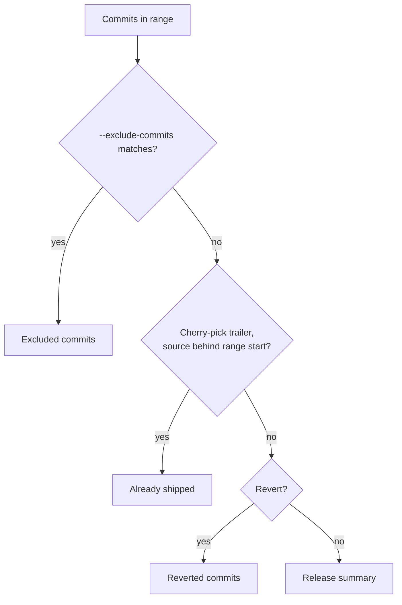
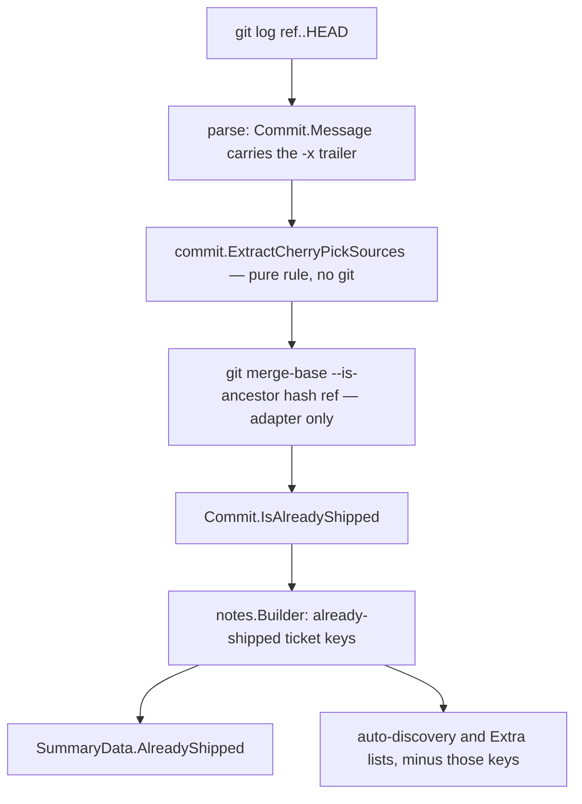

# Skip Already-Shipped Cherry-Picks - Plan

## Goal Capsule

- **Objective:** Stop shipnotes from presenting a re-landed change as new work. A commit in the range that cherry-picks something already behind the range start had its ticket released in an earlier cut; the release summary should say so instead of listing the ticket as part of this release.
- **Authority hierarchy:** The Product Contract wins on product behavior. A Key Technical Decision wins on mechanism within its cited requirements. An Implementation Unit overrides neither. `CLAUDE.md` and `ARCHITECTURE.md` govern code style and structure and outrank any convenience choice in this plan.
- **Execution profile:** One Go module, no new dependencies, no new flags. The output is byte-locked by golden files, so the rendering change is a reviewed diff.
- **Stop conditions:** Stop and ask if the work would require a new port on `commit.Repository`, a new CLI flag, a new dependency, or a change to what `<ref>..HEAD` means.
- **Tail ownership:** This plan ends at a green local build. It does not own commits, branches, or a PR.
- **Open blockers:** None.

---

## Product Contract

**Preservation note:** Restructured, no scope change. R5 was clarified from "the fallback" to name both auto-discovery paths (the no-`--jql` fallback and the `Extra` list). Planning found that a `--jql` run routes commit keys outside the selection into `Extra`, a second path the original wording did not reach; leaving it unstated would have let an already-shipped ticket resurface there. All other requirements and IDs are unchanged. The two Outstanding Questions the brainstorm deferred to planning are resolved as KTD4 and KTD5 and no longer appear as questions.

### Summary

Add a fourth gate to the notes pipeline. A commit whose message carries a `(cherry picked from commit <hash>)` trailer, where `<hash>` is an ancestor of the range start, is treated as already released. Its ticket leaves the release summary for a new "Already shipped" section, while the commit itself stays in the commit history table untouched.

### Problem Frame

A change can reach production twice on the same branch. A fix lands, gets cherry-picked onto a maintenance line, ships from there, and later returns to the mainline when that line merges back. By the time the next release range is cut, the returning commit sits inside `<ref>..HEAD` even though its ticket went out weeks ago.

shipnotes has no way to tell the difference. Every Jira key in the range is summarized, so a release manager reading the notes sees tickets that were closed and announced in a prior release, mixed in with genuinely new work. The cost lands on the reader: they have to remember which tickets already shipped, and there is nothing in the document to check that memory against. The existing `--exclude-commits` regexp can suppress them one key at a time, but that is manual, silent, and goes stale the moment the next release rolls around.

### Requirements

#### Detection

- R1. A commit in the range is *already shipped* when its message carries a `(cherry picked from commit <hash>)` trailer and `<hash>` is an ancestor of the range start.
- R2. When the referenced hash is not present in the local repository, the commit is not already shipped.
- R3. Detection is always on. No flag enables, disables, or configures it.

#### Ticket classification

- R4. A ticket is already shipped only when every commit in the range carrying that ticket key is already shipped per R1.
- R5. An already-shipped ticket is omitted from the auto-discovered issue summary. This covers both auto-discovery paths: the fallback that summarizes every key found in the range when no `--jql` is given, and the "Extra" list of commit keys that fall outside an explicit `--jql` selection.
- R6. A ticket named by `--jql` stays in the release summary even when R4 holds, and additionally appears in the already-shipped section.

#### Output

- R7. Already-shipped tickets appear in a dedicated "Already shipped" section of the release summary, showing issue key, title, and status.
- R8. Every already-shipped commit remains in the commit history table, rendered exactly as it is today.
- R9. The already-shipped section is omitted entirely when nothing was detected.
- R10. Authors of already-shipped commits stay credited under Participants.

#### Precedence with the existing gates

- R11. A commit matched by `--exclude-commits` is never evaluated for already-shipped; it appears only under "Excluded commits".
- R12. A commit that is both a revert and already shipped is listed in the "Reverted commits" callout rather than "Already shipped"; reverts already leave the issue summary, so the classification adds nothing.

### Key Decisions

- KD1. **Trailer over patch-id equivalence.** (session-settled: user-directed — chosen over `git cherry` patch-id matching: exact, one git call, and no look-back window to define.) Governs R1.
- KD2. **Pre-range history is the only reference point.** (session-settled: user-directed — chosen over a `--shipped-ref` naming a released branch or tag: keeps the tool zero-config.) Governs R1.
- KD3. **Relocate, don't delete.** (session-settled: user-directed — chosen over dropping the ticket silently: the notes stay auditable, matching the existing "Excluded commits" precedent.) Governs R7, R8.
- KD4. **A `--jql` selection appears in both lists rather than being reconciled.** (session-settled: user-directed — the discrepancy between what you expected to ship and what already shipped is the signal, and resolving it for the reader hides it.) Governs R6.
- KD5. **A ticket ships now unless all of its commits already shipped.** (session-settled: user-approved — the opposite rule would erase real work whenever a ticket spans a hotfix and a follow-up.) Governs R4.
- KD6. **Fail open on an unresolvable hash.** A shallow clone or a pruned source branch is missing data, not evidence of a release. Governs R2.
- KD7. **No flag.** A trailer plus an ancestor test is an objective fact about the repository, unlike the two opt-in opinions (`--checked-statuses`, `--exclude-commits`) that encode a workflow preference. Governs R3.

### Key Flows

- F1. Re-landed hotfix, no `--jql`
  - **Trigger:** A maintenance branch carrying `git cherry-pick -x` commits merges back to the mainline, then a release range is cut across the merge.
  - **Steps:** shipnotes reads the range; the returning commit's trailer resolves to a hash behind the range start; its ticket has no other commit in the range; the ticket moves to the already-shipped section.
  - **Outcome:** The release summary lists only new work. The already-shipped section names the ticket, and the commit history table still shows the commit.
  - **Covers:** R1, R4, R5, R7, R8

- F2. Re-landed hotfix inside an explicit release selection
  - **Trigger:** The same range, but `--jql` names the release issues and one of them is the already-shipped ticket.
  - **Steps:** Detection runs as in F1; the ticket is already shipped per R4 but was explicitly selected, so it stays grouped by status in the release summary and is also listed as already shipped.
  - **Outcome:** The reviewer sees the same ticket in two places and can tell that a ticket they expected to ship has in fact already gone out.
  - **Covers:** R6, R7

### Acceptance Examples

- AE1. **Covers R1, R4, R5, R7.** Given `PROJ-101` is carried by exactly one commit in the range, and that commit's trailer names a hash that is an ancestor of the range start, when notes are generated without `--jql`, then `PROJ-101` appears under "Already shipped" and nowhere else in the summary.
- AE2. **Covers R4.** Given `PROJ-102` is carried by two commits in the range, one an already-shipped cherry-pick and one new, when notes are generated, then `PROJ-102` is summarized as part of this release and does not appear under "Already shipped".
- AE3. **Covers R1.** Given a commit's trailer names a hash that is inside the range rather than behind its start, when notes are generated, then the commit is not already shipped and its ticket is summarized normally.
- AE4. **Covers R2.** Given a commit's trailer names a hash that does not exist in the local clone, when notes are generated, then the commit is not already shipped.
- AE5. **Covers R6.** Given `--jql` names `PROJ-103` and every commit carrying it in the range is already shipped, when notes are generated, then `PROJ-103` appears both in its status group in the release summary and under "Already shipped", and never under "Missing".
- AE6. **Covers R11.** Given a commit matches `--exclude-commits` and also carries an already-shipped trailer, when notes are generated, then it appears only under "Excluded commits".
- AE7. **Covers R9.** Given no commit in the range is already shipped, when notes are generated, then the output contains no "Already shipped" heading.

### Scope Boundaries

- Patch-id equivalence (`git cherry`). A cherry-pick made without `-x`, or one edited while resolving conflicts, is not detected.
- Comparing the range against a named released branch or tag.
- Detecting an original and its cherry-pick that both fall inside the same range.
- Rewriting, merging, or annotating rows in the commit history table.

### Dependencies / Assumptions

- The team cherry-picks with `git cherry-pick -x`, so the trailer is present. Without it nothing is detected and the output is unchanged from today.
- The clone contains the referenced source commits — a shallow clone degrades to no detection per R2.
- The range stays `<ref>..HEAD`; this plan adds no range syntax.
- The output is byte-locked by golden files, so the new section is a reviewed change to the rendering contract.

### Sources / Research

- `internal/domain/notes/builder.go` — `Build` establishes the existing gate order (exclude, then revert, then reapply) and the auto-discovery fallback that R5 narrows.
- `internal/domain/notes/exclude.go` — the relocate-don't-delete precedent KD3 follows.
- `internal/domain/notes/model.go` — `SummaryData` is where the new section joins `Reverted`, `Reapplied`, and `Excluded`.
- `internal/infrastructure/git/repository.go` — `Log` reads `<ref>..HEAD`, which fixes what "behind the range start" means; `run` returns an error on any non-zero git exit.
- `internal/infrastructure/git/parser.go` — `parseMessageAndTopic` already captures the full body, so the `-x` trailer reaches `Commit.Message` with no parser change.
- `internal/domain/commit/commit.go` — `ExtractIssueIDs` / `IsRevertTopic` are the shape a new message rule follows; issue keys are parsed from the subject only.
- `internal/infrastructure/git/repository_internal_test.go` — `TestRepositoryAgainstRealRepo` builds a temp repo with real `git` commands; the ancestry tests extend it.
- `internal/infrastructure/markdown/renderer_test.go` and `testdata/` — every `cases/*.json` fixture is rendered and compared byte-for-byte against its `golden/*.golden`.

---

## Planning Contract

### Key Technical Decisions

- KTD1. **Resolve already-shipped in the git adapter and carry it as a flag on the commit.** `commit.Commit` gains `IsAlreadyShipped`, filled by the adapter exactly as `IsRevert` and `IsReapply` are today. The trailer rule stays a pure function in the commit domain; only the ancestor test needs git, and the adapter already owns every git call. No new port on `commit.Repository`. Governs R1, R2.
- KTD2. **Treat any non-zero `git merge-base --is-ancestor` exit as "not shipped".** Exit 0 means ancestor, exit 1 means not, exit 128 means the hash is unknown. Collapsing them satisfies KD6's fail-open rule with no error branch to write. Governs R2.
- KTD3. **Accept only `[0-9a-f]{7,40}` from the trailer.** The hash arrives as untrusted commit-message text and is passed to `git`; the adapter's standing contract, recorded in its `//nolint:gosec` note, is that every ref reaching `exec` is format-validated first. Governs R1.
- KTD4. **A commit with several trailers is already shipped only when every referenced hash is an ancestor.** Resolves a question the Product Contract deferred to planning. The conservative arm keeps the ticket visible when the evidence is mixed, consistent with KD6. Governs R1.
- KTD5. **Render "Already shipped" grouped by status, reusing the `Extra` block's shape.** Resolves the second deferred question. Status becomes the group heading, so R7's three fields need no new line format and the template gains no new shape. Governs R7.
- KTD6. **Classify tickets from the post-revert commit set.** Running R4's every-commit test over `normalCommits` rather than all kept commits makes R12 fall out with no separate branch: reverts have already left that set. Governs R4, R12.

### High-Level Technical Design

Detection crosses one layer boundary and stops. The commit domain owns the message rule, the git adapter owns the ancestry question, and the notes domain owns everything downstream. Nothing else changes shape.

### Sequencing

U1 supplies the rule U2 and U3 both consume. U2 and U3 are independent of each other and can land in either order; U4 needs the model field from U3; U5 lands last so the docs describe shipped behavior.

---

## Implementation Units

### U1. Cherry-pick trailer rule in the commit domain

- **Goal:** A pure function that extracts the source hashes a commit message references, plus the field the adapter will fill.
- **Requirements:** R1, R2; KTD3, KTD4
- **Dependencies:** none
- **Files:** `internal/domain/commit/commit.go`, `internal/domain/commit/commit_test.go`
- **Approach:**
  1. Add `ExtractCherryPickSources(message string) []string` beside `ExtractIssueIDs`, backed by a package-level compiled regexp for git's `-x` trailer. Return de-duplicated hashes in first-seen order, always a non-nil slice.
  2. Constrain the hash capture per KTD3 so a malformed trailer yields no hash rather than an unvalidated string.
  3. Add `IsAlreadyShipped bool` to `Commit`, documented the way `IsRevert` and `IsReapply` are: derived from the message, filled by the adapter that builds the value.
- **Patterns to follow:** `ExtractIssueIDs` for the regexp-plus-dedupe shape and the non-nil return; the `Commit` doc comment that already explains adapter-filled classification fields.
- **Test scenarios:** table-driven, matching `commit_test.go`.
  - A message with one `-x` trailer returns that one hash.
  - A message with two trailers returns both, in first-seen order.
  - A message with no trailer returns an empty, non-nil slice.
  - An empty message returns an empty, non-nil slice.
  - A trailer whose hash is too short or contains non-hex characters yields no hash. Covers KTD3.
  - A trailer indented by leading whitespace still matches, since rebases and merge tooling reindent bodies.
  - The same hash referenced twice appears once.
- **Verification:** `go test ./internal/domain/commit/...` passes, and every value the function returns satisfies the adapter's hash-format constraint.

### U2. Ancestor resolution in the git adapter

- **Goal:** `Log` fills `IsAlreadyShipped` for every commit it returns.
- **Requirements:** R1, R2; KTD1, KTD2, KTD4
- **Dependencies:** U1
- **Files:** `internal/infrastructure/git/repository.go`, `internal/infrastructure/git/repository_internal_test.go`
- **Approach:**
  1. After `parse(output)` in `Log`, walk the parsed commits and call `commit.ExtractCherryPickSources` on each message. Skip commits with no sources — the common case, so most ranges add zero git calls.
  2. For each source hash, run `git merge-base --is-ancestor <hash> <ref>` against the same validated `ref` the log was read from.
  3. Set `IsAlreadyShipped` only when every source resolved as an ancestor, per KTD4.
  4. Treat any error from the git call as "not an ancestor" per KTD2, and never let it fail `Log`.
- **Patterns to follow:** the existing `r.run(ctx, ...)` helper and the format-validation discipline recorded in its `//nolint:gosec` note.
- **Test scenarios:** extend `TestRepositoryAgainstRealRepo`, which already builds a temp repo with real `git` commands.
  - A commit whose trailer names a commit before the range start sets the flag.
  - Covers AE3. A commit whose trailer names a commit inside the range leaves the flag false.
  - Covers AE4. A commit whose trailer names a hash absent from the repo leaves the flag false, and `Log` returns no error.
  - A commit with two trailers, one an ancestor and one not, leaves the flag false. Covers KTD4.
  - A commit with no trailer leaves the flag false and triggers no git call.
- **Verification:** `go test ./internal/infrastructure/git/...` passes and `Log` returns a nil error in every scenario above.

### U3. Already-shipped classification and summary section

- **Goal:** The builder computes already-shipped ticket keys and emits the new summary section.
- **Requirements:** R4, R5, R6, R7, R9, R10, R11, R12; KTD5, KTD6
- **Dependencies:** U1, U2
- **Files:** `internal/domain/notes/model.go`, `internal/domain/notes/builder.go`, `internal/domain/notes/builder_test.go`
- **Approach:**
  1. Add `AlreadyShipped []StatusGroup` to `SummaryData` with the `alreadyShipped` JSON tag, and include it in `isEmpty` so an otherwise-empty summary still renders when only this section has content.
  2. In `Build`, after `splitReverted`, compute the already-shipped key set from `normalCommits` per KTD6: a key qualifies when every commit in that set carrying it has `IsAlreadyShipped`.
  3. Subtract those keys from the no-`--jql` auto-discovery fallback (R5, first path).
  4. Add those keys to `keysToLoad` so the issue provider still supplies title and status for R7.
  5. In `buildSummary`, exclude those keys from `Extra` (R5, second path) while leaving `releaseIssueIDs` untouched so an explicit selection still lands in `ByStatus` (R6).
  6. Build the section with the existing `issueView` and `groupByStatus` helpers per KTD5.
- **Patterns to follow:** `splitExcluded` and `splitReverted` for the gate shape; `issueView` plus `groupByStatus` for the section; `toSet` and `sortedKeys` for the key arithmetic.
- **Test scenarios:**
  - Covers AE1. A ticket carried by one already-shipped commit, no `--jql`: appears in `AlreadyShipped`, absent from `ByStatus` and `Extra`.
  - Covers AE2. A ticket carried by one already-shipped and one normal commit: appears in the release summary, absent from `AlreadyShipped`.
  - Covers AE5. A `--jql`-named ticket whose commits are all already shipped: appears in both `ByStatus` and `AlreadyShipped`, and never in `Missing`.
  - An already-shipped ticket outside a `--jql` selection appears in `AlreadyShipped`, not `Extra`.
  - Covers AE6. A commit matching `--exclude-commits` that also carries a trailer appears only in `Excluded`.
  - Covers R12. A revert commit that is also already shipped appears in `Reverted` and contributes no key to `AlreadyShipped`.
  - Covers R8. Every already-shipped commit still appears in `Commits`, with its hash, topic, authors, and issue status unchanged.
  - Covers R10. Authors of already-shipped commits remain in `Authors`.
  - Covers AE7. With no already-shipped commits, `AlreadyShipped` is empty and an otherwise-empty summary is still nil.
- **Verification:** `go test ./internal/domain/notes/...` passes and no existing builder test needed a behavioral change.

### U4. Template and golden files

- **Goal:** Render the new section without disturbing any existing output.
- **Requirements:** R7, R9; KTD5
- **Dependencies:** U3
- **Files:** `internal/infrastructure/markdown/templates/shipnotes.tmpl`, `testdata/cases/already_shipped.json`, `testdata/golden/already_shipped.golden`
- **Approach:**
  1. Add an `## Already shipped` block between the `Extra` and `Reverted` blocks, mirroring `Extra`'s status-subheading-plus-checklist shape and matching its whitespace trimming.
  2. Guard the whole block on `{{ if .Summary.AlreadyShipped }}` so R9 holds and existing fixtures render byte-identically.
  3. Add a fixture exercising the section alongside a populated release summary, so the case proves ordering as well as content.
  4. Regenerate with `go test ./internal/infrastructure/markdown -update`, then review the diff — only the new golden file should appear.
- **Patterns to follow:** the `Extra` block in the template for grouping shape and `{{-`/`-}}` trimming; the existing `excluded.json` / `excluded.golden` pair for how a callout-focused fixture is built.
- **Test scenarios:**
  - Two already-shipped issues sharing one status render one group heading with both issues, ordered by issue number.
  - Two already-shipped issues with different statuses render two groups, ordered alphabetically by status.
  - Covers AE7. The pre-existing fixtures, none of which carry the field, render exactly as before.
- **Verification:** `go test ./internal/infrastructure/markdown/...` passes and `git diff` shows no change to any pre-existing `.golden` file.

### U5. Documentation sync

- **Goal:** `ARCHITECTURE.md`, `README.md`, and `CLAUDE.md` describe the shipped gate.
- **Requirements:** none directly — this unit satisfies the repository's mandatory architecture-sync rule.
- **Dependencies:** U1, U2, U3, U4
- **Files:** `ARCHITECTURE.md`, `README.md`, `CLAUDE.md`
- **Approach:**
  1. Update `ARCHITECTURE.md` per its own §12 mapping: the domain-internals entries for the new `Commit` field and `SummaryData` section, the runtime view for the extra git call inside `Log`, the output-contract note, and a decision entry recording trailer-matching over patch-id equivalence.
  2. Update `README.md` where it describes generated output, noting the section is automatic and depends on `git cherry-pick -x`.
  3. Update the workflow-agnostic paragraph in `CLAUDE.md` so the gate chain reads exclude, then already-shipped, then revert, and state that this gate is automatic rather than a third opt-in opinion.
  4. Run `npx markdownlint-cli2 --fix` and leave it reporting zero errors.
- **Patterns to follow:** the one-line-per-paragraph convention in `CLAUDE.md`; the existing `ARCHITECTURE.md` section shapes.
- **Test expectation:** none — documentation only.
- **Verification:** `npx markdownlint-cli2` reports zero issues, and every §12 row this change touches has a corresponding edit.

---

## Verification Contract

| Gate | Command | Applies to |
|------|---------|------------|
| Build | `go build ./...` | U1–U4 |
| Static checks | `go vet ./...` | U1–U4 |
| Tests | `go test ./...` | U1–U4 |
| Lint (must be zero issues) | `golangci-lint run ./...` | U1–U4 |
| Formatting (must print nothing) | `gofmt -l .` | U1–U4 |
| Markdown lint (must be zero issues) | `npx markdownlint-cli2` | U5 |

Two gates are specific to this change:

- Regenerated goldens must add exactly one file. A diff on any pre-existing `.golden` proves R8 or R9 was violated.
- `Log` must return a nil error for every fixture in U2, including the absent-hash case. A non-nil error there means KTD2's fail-open collapse was not applied.

---

## Definition of Done

### Global

- Every requirement R1–R12 is implemented and traced to a unit.
- Every acceptance example AE1–AE7 has a test that enforces it.
- All six Verification Contract gates pass.
- `go.mod` still has no `require` block — the change adds no dependency.
- No new CLI flag, environment variable, or configuration key exists.
- `ARCHITECTURE.md` is updated in this change, not deferred.
- No abandoned or experimental code remains in the diff.

### Per unit

- U1: `ExtractCherryPickSources` is pure, takes no git dependency, and rejects malformed hashes.
- U2: `Log` fills `IsAlreadyShipped` and never fails because of an unresolvable trailer.
- U3: The already-shipped key set is computed once and applied to both auto-discovery paths, with the `--jql` selection left intact.
- U4: The new section renders only when populated, and every pre-existing golden file is byte-identical.
- U5: The gate chain is described consistently across all three documents.
